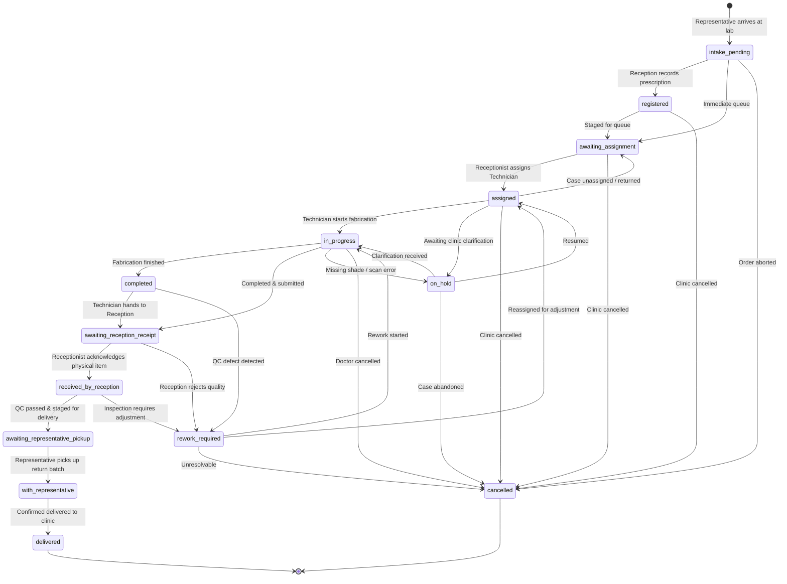

# Case Workflow & State Transition Specification

## 1. Case Lifecycle State Diagram

---

## 2. Stage Breakdown & Operational Requirements

### Stage A: Representative Brings Cases to Reception
- **Actor**: Representative.
- **Physical Action**: Arrives at reception with physical impression trays, bite registrations, and doctor prescription slips.
- **System Action**: Representative opens `/batches` $\rightarrow$ "New Batch", logs expected count and collection notes.
- **Distinction**: Physical batch is created as `intake`. Unregistered physical items remain untracked until individually registered.

### Stage B: Reception Registers Individual Cases
- **Actor**: Receptionist.
- **Physical Action**: Unpacks box, inspects impressions, reads prescription slip.
- **System Action**: Navigates to `/cases/new`. Enters patient name, age, dentist/clinic, case type (Crown, Bridge, etc.), tooth numbers, shade, due date, and priority.
- **System Generation**: Server generates atomic `CASE-YYYYMM-NNNNN`.
- **Assignment**: Receptionist may assign an active technician immediately or place into the unassigned queue (`awaiting_assignment`).

### Stage C: Technician Receives & Processes Work
- **Actor**: Assigned Technician.
- **Workbench**: Technician accesses their dedicated dashboard (`/`) displaying exclusively their workload.
- **System Action**:
  1. Reviews clinical instructions and shades.
  2. Clicks "Start Work" $\rightarrow$ status transitions to `in_progress`.
  3. If missing information (e.g., unclear margin or contradictory shade), clicks "Put on Hold", adding a required reason.
  4. Resumes work when clarification is documented.

### Stage D: Technician Returns Work to Reception
- **Actor**: Technician $\rightarrow$ Receptionist.
- **Physical Action**: Places finished restoration and model in outbound tray.
- **System Action (Tech)**: Clicks "Submit to Reception" $\rightarrow$ status transitions to `awaiting_reception_receipt`.
- **Crucial Invariant**: **This does NOT count as reception receiving it.**
- **System Action (Reception)**: Receptionist inspects tray at QC desk and clicks "Acknowledge Receipt" $\rightarrow$ status transitions to `received_by_reception`.

### Stage E: Reception Releases Case to Representative
- **Actor**: Receptionist.
- **Physical Action**: Packs verified case into delivery container.
- **System Action**: Moves status to `awaiting_representative_pickup`. Adds case to an outbound `return` delivery batch.
- **Representative Action**: Representative accepts physical batch and confirms pickup $\rightarrow$ status becomes `with_representative`.

### Stage F: Representative Delivers to Clinic
- **Actor**: Representative.
- **Physical Action**: Delivers package to doctor's front desk.
- **System Action**: Representative accesses Deliveries view on mobile/tablet, clicks "Confirm Delivery", logs recipient name and delivery notes $\rightarrow$ status transitions to `delivered` (terminal state).

---

## 3. Allowed Transitions Matrix (State Machine)

| Current Status | Permitted Next Statuses | Enforcing Actor |
| :--- | :--- | :--- |
| `intake_pending` | `registered`, `awaiting_assignment`, `cancelled` | Receptionist, Owner |
| `registered` | `awaiting_assignment`, `cancelled` | Receptionist, Owner |
| `awaiting_assignment` | `assigned`, `cancelled` | Receptionist, Owner |
| `assigned` | `in_progress`, `awaiting_assignment`, `on_hold`, `cancelled` | Assigned Tech, Owner |
| `in_progress` | `completed`, `awaiting_reception_receipt`, `on_hold`, `cancelled` | Assigned Tech, Owner |
| `completed` | `awaiting_reception_receipt`, `rework_required`, `cancelled` | Assigned Tech, Receptionist |
| `awaiting_reception_receipt`| `received_by_reception`, `rework_required`, `cancelled` | Receptionist, Owner |
| `received_by_reception` | `awaiting_representative_pickup`, `rework_required`, `cancelled` | Receptionist, Owner |
| `awaiting_representative_pickup` | `with_representative`, `cancelled` | Representative, Owner |
| `with_representative` | `delivered`, `cancelled` | Representative, Owner |
| `delivered` | *(Terminal — None)* | None |
| `on_hold` | `assigned`, `in_progress`, `awaiting_assignment`, `cancelled` | Assigned Tech, Owner |
| `rework_required` | `assigned`, `awaiting_assignment`, `in_progress`, `cancelled` | Receptionist, Owner |
| `cancelled` | *(Terminal — None)* | None |
